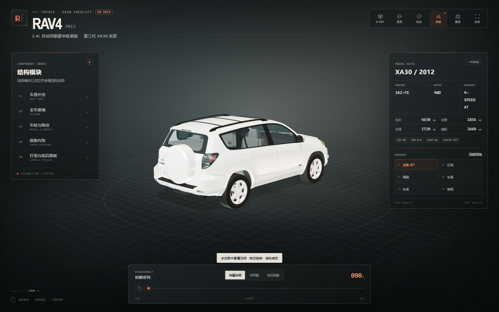

# 2012 丰田 RAV4 XA30 3D 拆解展示

可交互的 2012 款一汽丰田 RAV4 2.4L 自动四驱豪华炫装版 Three.js 展示页。



## 功能

- 鼠标拖拽旋转、滚轮缩放、右键平移；手机端单指旋转、双指缩放/平移
- 完整车辆 / 半拆解 / 完全拆解三档与拆解进度滑杆
- 点击部件查看中文说明，部件列表可定位
- X-RAY 透视、自动旋转、地面开关、全屏与截图
- 车底视角可查看底盘结构，地面辅助会自动隐藏
- 本地 Three.js 依赖与相对路径，适合 GitHub Pages 静态托管

## 技术

- Three.js + GLTFLoader
- 单文件 GLB 模型，模型与依赖均放在 `assets/` 内
- 无构建步骤，直接打开 `index.html` 即可（建议通过 HTTP 访问）

## 本地预览

```powershell
python -m http.server 8788 --bind 127.0.0.1
```

打开 `http://127.0.0.1:8788/`。

## 说明

车身比例与外覆件基于 XA30 平台 GLB 模型调校，并按 2012 款参数、白色车漆、黑色下包围、侧开尾门和外挂备胎配置了材质与交互。
